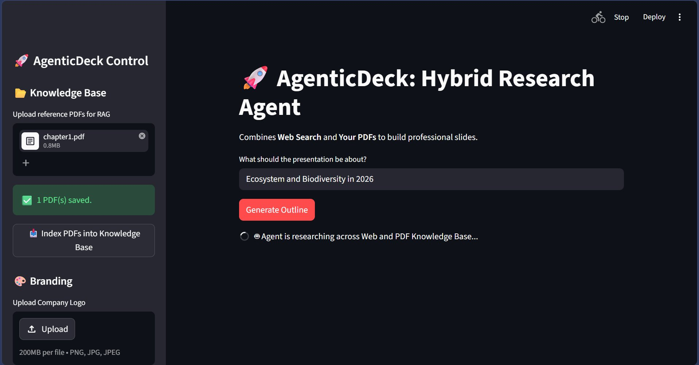
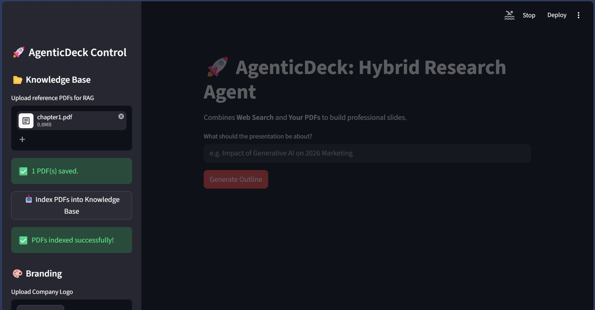
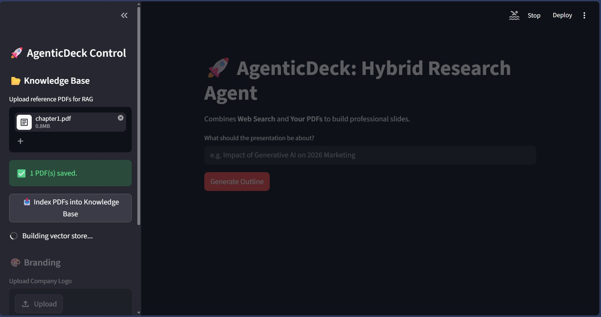
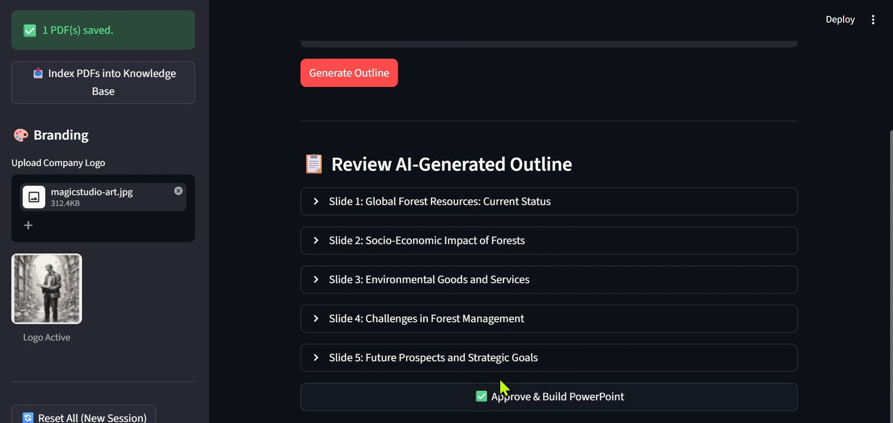
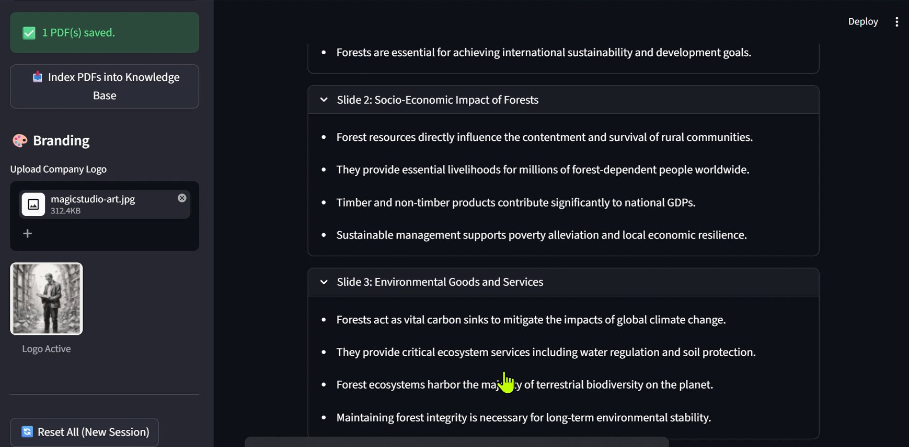
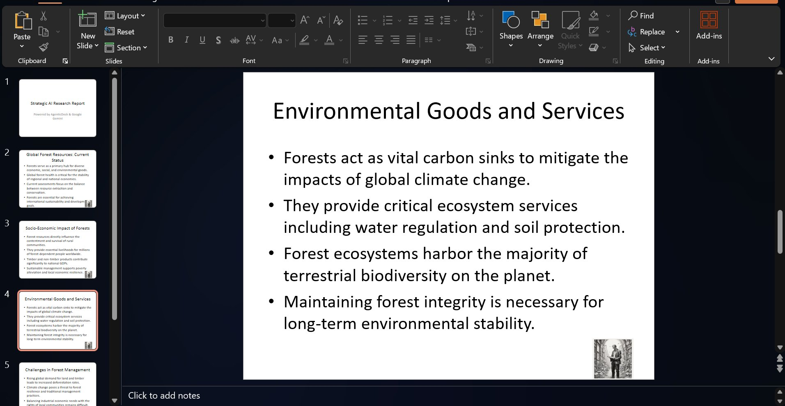

# 🚀 AgenticDeck — Hybrid AI Presentation Builder

> An agentic AI system that researches your topic across **Web + your own PDFs**, then builds a professional **PowerPoint presentation** — with human-in-the-loop review before generating the file.

Built with **LangGraph**, **Google Gemini**, **Tavily Search**, **ChromaDB**, and **Streamlit**.

---

## ✨ Features

- 🔍 **Hybrid RAG Research** — searches your uploaded PDFs first, falls back to live web search (Tavily) if no docs are available
- 🤖 **Gemini-Powered Architect** — turns research notes into a structured 5-slide outline
- 🧑‍💼 **Human-in-the-Loop** — review and approve the AI draft before the `.pptx` is built
- 🎨 **Custom Branding** — upload your company logo and it gets embedded into every slide
- 📥 **One-Click Download** — exports a ready-to-use `.pptx` file instantly

---

## 🏗️ Architecture

```
User Input (Topic)
       │
       ▼
┌─────────────────┐
│  Researcher Node │  ← RAG (ChromaDB + PDFs) OR Web Search (Tavily)
└────────┬────────┘
         │  research_notes
         ▼
┌─────────────────┐
│  Architect Node  │  ← Google Gemini generates 5-slide JSON outline
└────────┬────────┘
         │  slides_json
         ▼
┌─────────────────┐
│  Human Review   │  ← LangGraph interrupt() — Streamlit shows draft
└────────┬────────┘
         │  approved
         ▼
┌─────────────────┐
│  PPT Builder    │  ← python-pptx builds .pptx in memory
└─────────────────┘
         │
         ▼
   📥 Download .pptx
```

The graph is powered by **LangGraph** with `MemorySaver` checkpointing, enabling the interrupt-resume pattern for human review.

---

## 🛠️ Tech Stack

| Layer | Technology |
|-------|-----------|
| Agent Framework | LangGraph |
| LLM | Google Gemini 2.5 Flash |
| Web Search | Tavily API |
| Vector Store | ChromaDB |
| Embeddings | HuggingFace `all-MiniLM-L6-v2` (local, no API needed) |
| PDF Parsing | PyPDF + LangChain DirectoryLoader |
| Presentation | python-pptx |
| UI | Streamlit |

---

## ⚙️ Setup & Installation

### Prerequisites
- Python 3.10+
- A [Google AI Studio API key](https://aistudio.google.com/apikey) (free)
- A [Tavily API key](https://tavily.com) (free tier available)

### 1. Clone the repository
```bash
git clone https://github.com/tirfan022/agentic_deck_.git
cd agentic-deck
```

### 2. Create and activate a virtual environment
```bash
# Windows
python -m venv venv
venv\Scripts\activate

# Mac/Linux
python -m venv venv
source venv/bin/activate
```

### 3. Install dependencies
```bash
pip install -r requirements.txt
```

### 4. Set up environment variables
Create a `.env` file in the project root:
```
GOOGLE_API_KEY=your_google_api_key_here
TAVILY_API_KEY=your_tavily_api_key_here
```

### 5. Run the app
```bash
# Windows (recommended)
.\venv\Scripts\python.exe -m streamlit run app.py

# Mac/Linux
streamlit run app.py
```

Open **http://localhost:8501** in your browser.

---

## 🚀 How to Use

1. **(Optional)** Upload reference PDFs in the sidebar → click **"Index PDFs"** to build the knowledge base
2. **(Optional)** Upload your company logo for branded slides
3. Enter your presentation topic in the main input
4. Click **"Generate Outline"** — the agent researches and drafts slides
5. Review the AI-generated outline (expand each slide)
6. Click **"Approve & Build PowerPoint"**
7. Download your `.pptx` file!

---

## 📁 Project Structure

```
agentic_deck/
├── app.py                  # Streamlit UI + LangGraph orchestration
├── requirements.txt
├── .env                    # API keys (not committed)
├── src/
│   ├── agent/
│   │   ├── graph.py        # LangGraph graph definition
│   │   ├── nodes.py        # Researcher + Architect nodes
│   │   └── state.py        # AgentState TypedDict
│   └── tools/
│       ├── rag_service.py  # ChromaDB RAG pipeline
│       ├── web_scout.py    # Tavily web search
│       └── ppt_builder.py  # python-pptx presentation builder
├── knowledge_base/         # Upload PDFs here (gitignored)
├── vector_store/           # ChromaDB persisted index (gitignored)
└── output/                 # Logo + generated files (gitignored)
```

---

## 📸 Screenshots

### 1. Upload PDF & Start Research
Upload your reference PDFs to the knowledge base, enter your topic, and click **Generate Outline**. The agent begins researching across your documents and the web.



---

### 2. PDFs Indexed Successfully
After clicking **Index PDFs into Knowledge Base**, ChromaDB builds a vector store from your documents — ready for semantic search.



---

### 3. Building Vector Store
The app shows a live spinner while chunking your PDFs and embedding them into ChromaDB using the local `all-MiniLM-L6-v2` model.



---

### 4. AI-Generated Outline (Human Review)
Gemini returns a structured 5-slide outline. You can expand each slide to review the content before approving.



---

### 5. Slide Content Preview
Expand individual slides to read the AI-generated bullet points, sourced directly from your uploaded PDFs via RAG.



---

### 6. Final PowerPoint Output
After approval, the `.pptx` is built instantly with your logo embedded in every slide — ready to download and present.



---

## 🔮 Future Improvements

- [ ] Edit slide content directly in the UI before approving
- [ ] Support for multiple presentation themes/templates
- [ ] Export to Google Slides via API
- [ ] Multi-agent refinement loop (critic + revisor agents)
- [ ] Streaming output for real-time research visibility

---

## 📄 License

MIT License — free to use and modify.

---

## 🙏 Acknowledgements

- [LangGraph](https://github.com/langchain-ai/langgraph) for the agentic framework
- [Google Gemini](https://ai.google.dev/) for the LLM
- [Tavily](https://tavily.com/) for real-time web search
- [ChromaDB](https://www.trychroma.com/) for the vector store